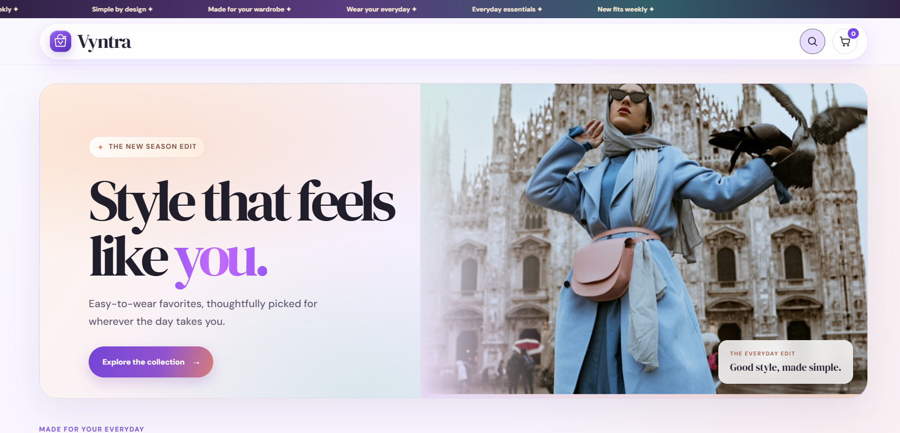
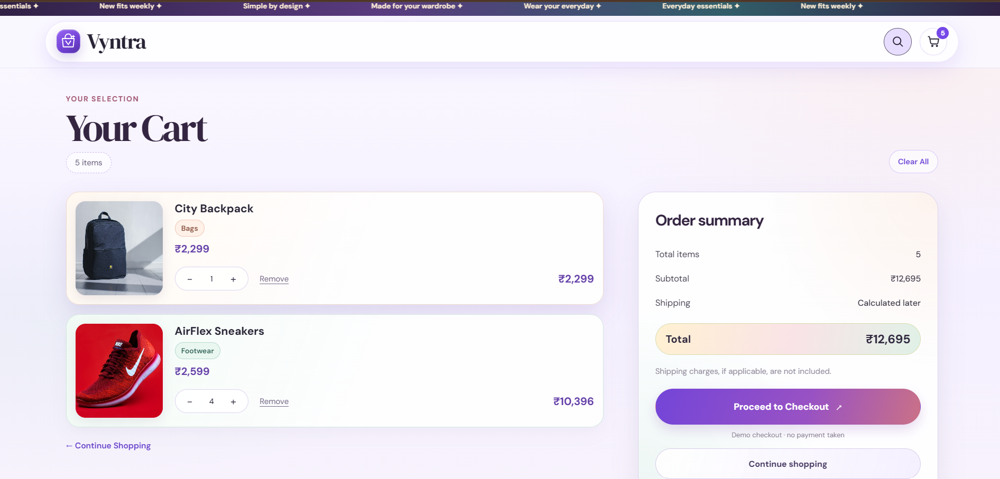

# Vyntra

Vyntra is a responsive mini e-commerce storefront built with React. It uses a local product catalog and lets shoppers browse and filter items, view product details, and manage a cart that persists in the browser.

**Live demo:** [product-store-kappa-two.vercel.app](https://product-store-kappa-two.vercel.app)

## Screenshots

### Home page



### Cart page




## Features

- Browse a local catalog of fashion, footwear, accessories, and bags
- Search products and filter by category
- Sort products by rating or price
- Open a dedicated product page with image, category, rating, price, and description
- Choose a quantity, add items to the cart, or use the demo Buy Now flow
- Update quantities, remove items, clear the cart, and view item count and total
- Persist cart contents in `localStorage`
- Show empty states for unmatched searches, invalid product routes, and an empty cart
- Use local product images with a fallback when an image is unavailable
- Responsive layouts, keyboard focus styles, and reduced-motion support
- Demo checkout confirmation; no payment is processed

## Run locally

### Requirements

- Node.js 20.19+ or 22.12+
- npm

### Install and start

```sh
npm install
npm run dev
```

Open the local URL printed by Vite.

## Available commands

| Command | Description |
|---|---|
| `npm run dev` | Start the development server |
| `npm run build` | Create the production build in `dist/` |
| `npm run preview` | Preview the production build locally |
| `npm run lint` | Run Oxlint |

There is no automated test script configured yet. Use `npm run lint` and `npm run build` for basic code and production-build checks.

## Project structure

```text
public/
└── products/              # Local product photos
src/
├── components/
│   └── Reveal.jsx
├── context/
│   ├── CartProvider.jsx
│   ├── CartState.js
│   └── useCart.js
├── data/
│   └── products.json      # Local product catalog
├── App.jsx                # Pages, routes, and shared UI
├── App.css
├── index.css
├── main.jsx
└── motion.css
```

## Tech stack

- React and JavaScript
- Vite
- React Router
- React Context for shared cart state
- Browser `localStorage` for cart persistence
- Oxlint

Google Fonts are loaded from the internet; system fonts are used if they are unavailable. This demo does not include a backend, authentication, or payment processing.
